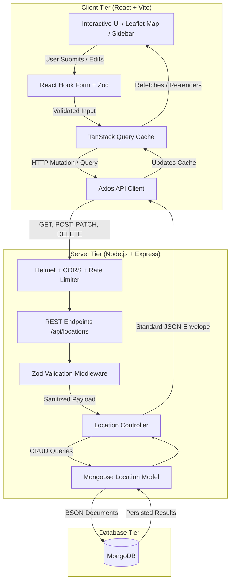

# Spotly — Interactive Places Explorer

> A professional, production-minded MERN stack web application centered around an interactive map for discovering, creating, and curating geographic locations.

[](https://www.typescriptlang.org/)
[](https://react.dev/)
[](https://expressjs.com/)
[](https://mongoosejs.com/)
[](https://tailwindcss.com/)
[]()

---

## 1. Project Overview

**Spotly** was built to demonstrate modern full-stack engineering fundamentals: clean decoupled architecture, strict type safety, real database persistence (no mock arrays or localStorage), and a refined, accessible UI inspired by modern SaaS applications like Linear and Vercel.

The application allows users to explore places on an interactive Leaflet map centered on Chandigarh, India, filter them by category, search by name, view synchronized sidebar cards, add new locations via modal or direct map-coordinate selection, edit details, and delete entries with safety confirmation barriers.

---

## 2. Core Features

1. **Interactive Leaflet Map**: Smooth zoom, pan, and dynamic bounds centered on Chandigarh (30.7333° N, 76.7794° E).
2. **Dynamic Category Pins**: Custom SVG `divIcon` pins color-coded by category (`cafe`, `park`, `landmark`, `store`, `service`) with pulsing selection rings.
3. **Card-to-Map Synchronization**: Clicking any location card in the sidebar smoothly animates (`flyTo`) the map viewport to that marker and highlights it.
4. **Live Search**: Instant, case-insensitive substring search across location names with safe regex escaping.
5. **Category Filtering**: Fast category chips with real-time result counters and reset capabilities.
6. **"Add on Map" Mode**: Interactive coordinate capture mode where clicking any point on the map retrieves precise latitude and longitude and opens the pre-populated creation form.
7. **Form Validation**: Strict client and server input validation using mirrored Zod schemas enforcing string bounds and coordinate limits (-90° to 90° lat, -180° to 180° lng).
8. **Edit & Delete Workflows**: In-place edits with pre-filled inputs and destructive confirmation dialogs preventing accidental deletions.
9. **Optimistic & Resilient Server State**: Powered by TanStack Query v5 with automatic query invalidation, background synchronization, and toast feedback via Sonner.
10. **Responsive Layout**: Intentional responsive design with a full-height desktop layout and dedicated mobile tab switcher between the explorer map and places drawer.
11. **Loading & Empty States**: Polished skeleton loaders, search-with-no-results states, empty database placeholders, and network retry mechanisms.

---

## 3. Technology Stack

### Frontend
- **Framework**: React 18 with TypeScript & Vite
- **Styling**: Tailwind CSS with custom slate & indigo design tokens
- **Map Engine**: Leaflet & React Leaflet with OpenStreetMap tiles
- **Server State**: TanStack Query (React Query v5)
- **HTTP Client**: Axios with centralized base URL configuration
- **Form Handling**: React Hook Form with `@hookform/resolvers/zod`
- **Validation**: Zod
- **Icons**: Lucide React
- **Toast Notifications**: Sonner

### Backend
- **Runtime**: Node.js with TypeScript (`tsx` for dev, `tsc` for production)
- **Framework**: Express.js
- **Database & ODM**: MongoDB & Mongoose 8
- **Input Validation**: Zod request schema middleware
- **Security**: Helmet (HTTP security headers), CORS (configured origins), `express-rate-limit`
- **Architecture**: Modular domain structure (`modules/locations/`)

### Automated Testing
- **Test Runner**: Vitest (ESM native runner)
- **Backend Testing**: Supertest against test database
- **Frontend Testing**: React Testing Library & jsdom with `@testing-library/jest-dom`

---

## 4. System Architecture



---

## 5. Directory Structure

```text
spotly/
├── client/                     # Vite + React TypeScript frontend
│   ├── src/
│   │   ├── app/                # App container & QueryClient provider
│   │   │   ├── App.tsx
│   │   │   └── queryClient.ts
│   │   ├── components/         # Shared UI & layout components
│   │   │   ├── layout/         # Header & responsive navigation
│   │   │   └── ui/             # Button, Input, Modal, Skeleton
│   │   ├── features/           # Domain feature module
│   │   │   └── locations/
│   │   │       ├── api/        # Axios API client & endpoints
│   │   │       ├── components/ # Map, Card, Sidebar, Modals, Badge
│   │   │       ├── hooks/      # TanStack Query & mutation hooks
│   │   │       ├── schemas/    # Zod validation schema
│   │   │       └── types.ts    # Frontend domain interfaces
│   │   ├── lib/                # Utility helpers (cn, formatters)
│   │   ├── styles/             # Global CSS with Leaflet styling
│   │   └── test/               # React Testing Library unit tests
│   ├── .env.example
│   └── package.json
│
├── server/                     # Express + TypeScript backend
│   ├── src/
│   │   ├── config/             # Environment validation & DB connection
│   │   ├── middleware/         # Zod validation & centralized error handler
│   │   ├── modules/            # Domain module
│   │   │   └── locations/
│   │   │       ├── location.controller.ts
│   │   │       ├── location.model.ts
│   │   │       ├── location.routes.ts
│   │   │       └── location.schema.ts
│   │   ├── utils/              # API responses & regex sanitizer
│   │   ├── app.ts              # Express application factory
│   │   └── index.ts            # Server entrypoint & graceful shutdown
│   ├── scripts/                # Idempotent demo database seeder
│   ├── tests/                  # Supertest integration tests
│   ├── .env.example
│   └── package.json
│
├── docs/                       # Project documentation
│   ├── PROJECT.md              # Requirements & progress checklist
│   ├── ARCHITECTURE.md         # Architecture decisions & tradeoffs
│   └── API.md                  # Detailed REST API specification
├── AGENTS.md                   # Assistant & engineering rules
├── README.md                   # Primary documentation
└── package.json                # Monorepo workspaces & root scripts
```

---

## 6. Local Setup Instructions

### Prerequisites
- **Node.js**: v18.0.0 or later (Tested on Node v22.14.0)
- **npm**: v9.0.0 or later
- **MongoDB**: Local MongoDB instance running on `mongodb://127.0.0.1:27017` or a MongoDB Atlas connection string.

### 1. Clone & Install Dependencies
From the repository root:
```bash
npm install
```

### 2. Configure Environment Variables
Copy the example environment files for both workspaces:
```bash
# Server environment
cp server/.env.example server/.env

# Client environment
cp client/.env.example client/.env
```

Default local configuration (`server/.env`):
```env
PORT=4000
NODE_ENV=development
MONGODB_URI=mongodb://127.0.0.1:27017/spotly
CORS_ORIGINS=http://localhost:5173,http://127.0.0.1:5173
```

Default local configuration (`client/.env`):
```env
# In development, the Vite proxy directs /api to http://localhost:4000
VITE_API_BASE_URL=
```

### 3. Seed the Database
Populate MongoDB with 12 curated demo locations across Chandigarh:
```bash
npm run seed
```

### 4. Start Development Server
Run both client and server concurrently with one command:
```bash
npm run dev
```

- **Frontend**: `http://localhost:5173`
- **Backend API**: `http://localhost:4000/api`
- **Health Check**: `http://localhost:4000/api/health`

---

## 7. Automated Test Suite & Quality Gates

Spotly includes automated tests across both frontend and backend layers:

### Run All Tests
```bash
npm run test
```

### Run Type Checks
```bash
npm run typecheck
```

### Build All Workspaces
```bash
npm run build
```

### Verification Results Summary:
- **Backend Integration Tests (Vitest + Supertest)**:
  - 12/12 tests passing (`tests/location.test.ts`) covering all CRUD endpoints, search, filtering, and validation error status codes.
- **Frontend Component Tests (Vitest + React Testing Library)**:
  - 6/6 tests passing (`src/test/LocationFeatures.test.tsx`) covering card rendering, category badges, empty states, and Zod form schemas.
- **Type Safety**:
  - `tsc --noEmit` passing with 0 warnings across client and server.

---

## 8. REST API Endpoints Summary

| Method | Endpoint | Description |
| :--- | :--- | :--- |
| `GET` | `/api/health` | Service health status and database connectivity check |
| `GET` | `/api/locations` | List all locations (Supports `?search=` and `?category=`) |
| `GET` | `/api/locations/:id` | Retrieve single location by ID |
| `POST` | `/api/locations` | Create a new location with validated payload |
| `PATCH` | `/api/locations/:id` | Update existing location details or coordinates |
| `DELETE` | `/api/locations/:id` | Delete location with confirmation |

Full request/response examples and error schemas are documented in [docs/API.md](docs/API.md).

---

## 9. Deployment Preparation

### Frontend (Vercel)
1. Link the repository to Vercel and specify Root Directory as `client`.
2. Build command: `npm run build`
3. Output directory: `dist`
4. Set environment variable: `VITE_API_BASE_URL=https://<your-render-backend-url>`

### Backend (Render)
1. Create a Web Service on Render pointing to the repository root or `server` directory.
2. Build command: `npm install && npm run build`
3. Start command: `node dist/index.js`
4. Environment variables:
   - `PORT=10000` (or Render default)
   - `NODE_ENV=production`
   - `MONGODB_URI=mongodb+srv://<username>:<password>@cluster0.mongodb.net/spotly?retryWrites=true&w=majority`
   - `CORS_ORIGINS=https://<your-vercel-domain>.vercel.app`

---

## 10. Technical Decisions & Tradeoffs

1. **TanStack Query over Redux**: Location discovery is predominantly server-state driven. TanStack Query eliminates hundreds of lines of boilerplate reducer logic while providing automatic query caching, background polling, and mutation invalidation.
2. **React Leaflet with OpenStreetMap**: Provides full map interaction (panning, zooming, marker placement, custom HTML DivIcons) without requiring proprietary paid API keys or credit card quotas.
3. **Regex Search Sanitization**: Search is executed with `escapeRegex` to prevent ReDoS attacks or syntax errors when users type characters like `(`, `[`, or `*`.
4. **Idempotent Seed Script**: The seeding script uses `findOneAndUpdate` with `{ upsert: true }` keyed on place name, ensuring demo places can be initialized without clearing user-created records.
5. **No Authentication in Initial Version**: Follows the assignment scope constraint to prioritize rock-solid CRUD mechanics, map precision, and validation reliability over partial or buggy auth implementations.

---

## 11. Known Limitations

- **Map Tiles Rate Limit**: OpenStreetMap community tiles are intended for development and demo testing. Production scale traffic should be backed by a dedicated provider (e.g., Mapbox, Stadia Maps, or self-hosted tile servers).
- **Public Write Access**: In the absence of an authentication layer, CRUD endpoints are open to all users. Basic defense is provided by IP-based rate limiting (`express-rate-limit`).
