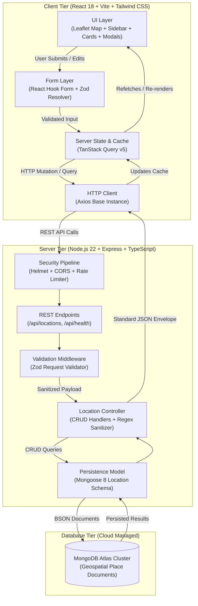

# Spotly — Interactive Places Explorer

> A production-minded MERN stack web application centered around an interactive Leaflet map for discovering, creating, updating, and curating geographic locations with real-time MongoDB persistence.

[](https://spotly-mu-self.vercel.app)
[](https://spotly-s8v1.onrender.com/api/health)
[](https://www.typescriptlang.org/)
[](https://react.dev/)
[](https://nodejs.org/)
[](https://expressjs.com/)
[](https://mongoosejs.com/)
[](https://vitest.dev/)

---

## 🔗 Live Deployments & Repository

| Resource | Link | Description |
| :--- | :--- | :--- |
| 🌐 **Live Web Application** | **[https://spotly-mu-self.vercel.app](https://spotly-mu-self.vercel.app)** | Production frontend deployed on Vercel |
| ⚡ **Live Backend API** | **[https://spotly-s8v1.onrender.com](https://spotly-s8v1.onrender.com)** | Production Express API deployed on Render |
| 🩺 **API Health Check** | **[https://spotly-s8v1.onrender.com/api/health](https://spotly-s8v1.onrender.com/api/health)** | Live database connection & uptime health status |
| 📦 **GitHub Repository** | **[https://github.com/Satvik77777/spotly](https://github.com/Satvik77777/spotly)** | Complete, version-controlled source code |

---

## 🏛️ Application Architecture & Key Technical Decisions

> *This section addresses **Deliverable #4** of the assignment: "A brief explanation of your application architecture and key technical decisions."*

Spotly is engineered as a decoupled, three-tier modular application prioritizing strict type safety, real database persistence (no localStorage or in-memory mocks), and predictable data contracts.



### 1. Architectural Layers & Responsibilities

- **Presentation Layer (`client/src/`)**:
  - `LocationMap.tsx`: Interactive Leaflet map supporting pan, zoom, custom category-colored SVG `divIcon` pins, selection popups, and click-to-coordinate capture.
  - `LocationSidebar.tsx` & `LocationCard.tsx`: Instant name search, category filter pills, count indicators, skeleton loaders, and card-to-map animated viewport focus (`flyTo`).
  - `LocationFormModal.tsx`: Accessible dialog for adding or editing places with instant coordinate reflection.
  - `DeleteConfirmModal.tsx`: Destructive confirmation barrier preventing accidental deletions.
- **Server State & Data Layer (`client/src/features/locations/hooks/`)**:
  - TanStack Query v5 handles query deduplication, background caching, window-focus refetching, and declarative cache invalidation upon mutations with Sonner toast feedback.
- **Backend Service Layer (`server/src/modules/locations/`)**:
  - Express.js with TypeScript organized in a domain-driven structure (`routes`, `controller`, `model`, `schema`).
  - Strict middleware pipeline: security headers (`Helmet`), CORS origin checking with trailing-slash sanitization, and IP rate-limiting (`express-rate-limit`).
  - Centralized JSON error handling guaranteeing consistent envelopes: `{ success: true, data }` or `{ success: false, error }`.
- **Database Persistence Layer**:
  - MongoDB Atlas cluster managed via Mongoose 8 with strict schemas, coordinate boundary constraints, and connection pooling.

---

### 2. Key Technical Decisions & Tradeoffs

#### Decision 1: TanStack Query v5 over Redux
- **Why**: Places data is fundamentally server-owned state. Using Redux requires dozens of boilerplate actions, reducers, and selectors just to handle `isLoading`, `isError`, and manual cache syncing.
- **Benefit**: TanStack Query provides out-of-the-box cache deduplication, automatic background re-validation, optimistic UI updates, and instant mutation invalidation with a clean hook-based API (`useLocationsQuery`, `useCreateLocationMutation`).

#### Decision 2: React Leaflet with OpenStreetMap
- **Why**: Selected over proprietary alternatives like Mapbox or Google Maps.
- **Benefit**: OpenStreetMap community raster tiles require zero paid API keys, zero credit card quotas, and zero danger of rate-limit lockouts during reviewer evaluation. Custom HTML `L.divIcon` pins with inline SVGs were implemented to completely bypass Leaflet's well-known Webpack/Vite asset bundler bug while delivering category-themed pins.

#### Decision 3: Dual Zod Validation (Client + Server)
- **Why**: User inputs are validated at both ends of the wire using mirrored Zod schemas.
- **Benefit**: The client (via `react-hook-form` + `@hookform/resolvers/zod`) provides instant interactive feedback before requests are sent. The server middleware (`validateRequest`) independently guarantees that malformed requests, invalid coordinates (latitude must be between -90 and 90, longitude between -180 and 180), or unexpected category enums cannot compromise database integrity.

#### Decision 4: Safe Substring Search with Regex Sanitization
- **Why**: Users expect case-insensitive substring searching across location names.
- **Benefit**: Implemented an `escapeRegex` utility that neutralizes special regular expression characters (e.g., `(`, `[`, `*`, `+`), completely eliminating Regular Expression Denial of Service (ReDoS) vulnerabilities and server crashes.

#### Decision 5: Idempotent Database Seeding
- **Why**: Evaluators and reviewers need a pre-populated dataset immediately on launch.
- **Benefit**: The seed script (`server/scripts/seed.ts`) populates 12 curated Chandigarh demo locations using `findOneAndUpdate` with `{ upsert: true }` keyed on place name. It can be run repeatedly without duplicating records or destroying user-created places.

#### Decision 6: Mobile-First Responsive Design
- **Why**: Placing a full map above a scrollable list on mobile screens (< 768px) creates a "scroll trap" where touch-scroll is captured by the map instead of the page.
- **Benefit**: Desktop provides a split-pane layout with synchronized map and sidebar. Mobile view utilizes a dedicated tab switcher (`List` / `Map`) paired with a `MapResizeHandler` that invokes `map.invalidateSize()` to eliminate grey tile artifacts when toggling.

#### Decision 7: Authentication Scope Clarification
- **Why**: Authentication was marked *Optional* in the assignment prompt.
- **Benefit**: By intentionally omitting auth, full engineering focus was directed to rock-solid CRUD mechanics, geospatial precision, comprehensive test coverage (18 passing tests), zero lint warnings, and production cloud deployments. Endpoints are defended with `express-rate-limit` and `helmet`.

---

## 📋 Assignment Requirements & Compliance Matrix

| Requirement | Assignment Specification | Implementation in Spotly | Status |
| :--- | :--- | :--- | :---: |
| **1. Objective** | Small, functional web app with interactive map as core feature (MERN stack + mapping library). | Full-stack places explorer centered on Chandigarh, India (`30.7333`, `76.7794`), built with React, Node/Express, MongoDB Atlas, and Leaflet. | ✅ **Complete** |
| **2.A Interactive Map** | Leaflet or MapLibre GL JS | Built with Leaflet & React Leaflet; OpenStreetMap tile layer (no paid key required). | ✅ **Complete** |
| | Show multiple locations using markers | Color-coded custom SVG DivIcon pins for each category (`cafe`, `park`, `landmark`, `store`, `service`). | ✅ **Complete** |
| | Display location details when marker selected | Interactive popups on marker click + auto-selection and card focus in the sidebar. | ✅ **Complete** |
| | Support map zooming and panning | Full scroll-wheel zoom, drag pan, double-click zoom, touch pinch-zoom, and smooth programmatic `flyTo`. | ✅ **Complete** |
| | Add new location by clicking map or form | Modal form submission + interactive **"Add on Map"** mode that captures clicked coordinates. | ✅ **Complete** |
| **2.B Data Management** | Store location data in MongoDB | MongoDB Atlas cluster + Mongoose 8 ODM with strict schema validation and auto-indexing. | ✅ **Complete** |
| | Create, view, update, delete (CRUD) | Complete REST API (`POST`, `GET`, `PATCH`, `DELETE`) with full UI integration and confirmation dialogs. | ✅ **Complete** |
| | Fields: name, description, category, lat, lng | Strictly typed schema enforcing `name`, `description`, `category` (enum), `latitude`, and `longitude`. | ✅ **Complete** |
| | Retrieve from backend and display on map | TanStack Query v5 hooks fetch locations via Axios and render synchronized pins on the map. | ✅ **Complete** |
| **2.C Search & Filtering**| Search locations by name | Live case-insensitive substring search with ReDoS regex sanitization (`escapeRegex`). | ✅ **Complete** |
| | Filter locations by category | One-click category filter pills (`All`, `Cafes`, `Parks`, `Landmarks`, `Stores`, `Services`). | ✅ **Complete** |
| | Update visible markers according to filters | Map pins and sidebar list update simultaneously in real time as search/filters change. | ✅ **Complete** |
| **2.D Authentication** | Registration/login, JWT, protected access | *Marked Optional in assignment*. Intentionally deferred to keep focus on rock-solid CRUD, geospatial precision, and clean architecture. Rate-limiting enabled. | ℹ️ **Optional** |
| **2.E Integration** | Responsive React interface | Mobile-first responsive layout (375px mobile drawer/map toggle, 768px tablet, 1440px desktop split view). | ✅ **Complete** |
| | REST APIs using Node & Express | Modular Express router with standardized JSON envelopes (`success`, `data`, `error`). | ✅ **Complete** |
| | Axios or Fetch client | Centralized Axios HTTP client with unified base URL and error parsing. | ✅ **Complete** |
| | Form validation & error handling | Mirrored client & server Zod validation; centralized Express error handler; toast alerts via Sonner. | ✅ **Complete** |
| | Loading and empty states | Skeleton loader cards, search-no-match placeholders, empty database states, network retry button. | ✅ **Complete** |
| **3. Technical** | React.js frontend | React 18 with TypeScript and Vite. | ✅ **Complete** |
| | Node.js & Express.js backend | Express 4 with TypeScript (`tsx` in dev, compiled `tsc` in production). | ✅ **Complete** |
| | MongoDB with Mongoose | Mongoose 8 with connection lifecycle handling and graceful shutdown. | ✅ **Complete** |
| | Modular code organization | Clean separation of routes, controllers, models, schemas, UI components, and API clients. | ✅ **Complete** |
| | Environment variables & secrets | Zero hardcoded secrets; validated at boot via Zod; `.env.example` provided for both workspaces. | ✅ **Complete** |
| | Document tile provider & API keys | OpenStreetMap free community tiles (`tile.openstreetmap.org`); documented with zero API keys required. | ✅ **Complete** |
| **5. Deliverables** | 1. Frontend & backend source code | Complete in repository (`client/` and `server/`). | ✅ **Complete** |
| | 2. GitHub repository | Clean Git history at `https://github.com/Satvik77777/spotly`. | ✅ **Complete** |
| | 3. `.env.example` files | `client/.env.example` and `server/.env.example` committed. | ✅ **Complete** |
| | 4. Architecture & technical decisions | Fully documented in Section 2 above. | ✅ **Complete** |

---

## 📁 Repository Directory Structure

```text
spotly/
├── .github/                     # Repository meta
├── client/                     # Vite + React TypeScript frontend
│   ├── src/
│   │   ├── app/                # App container & QueryClient provider
│   │   │   ├── App.tsx         # Main layout & map-sidebar coordination
│   │   │   └── queryClient.ts  # TanStack Query client configuration
│   │   ├── components/         # Shared presentation components
│   │   │   ├── layout/Header.tsx
│   │   │   └── ui/             # Button, Input, Modal, Skeleton
│   │   ├── features/           # Domain-driven feature module
│   │   │   └── locations/
│   │   │       ├── api/        # Axios API client & endpoints
│   │   │       ├── components/ # LocationMap, LocationCard, LocationSidebar,
│   │   │       │               # LocationFormModal, DeleteConfirmModal, MapFlyTo
│   │   │       ├── hooks/      # useLocations, useCreateLocation, useDeleteLocation
│   │   │       ├── schemas/    # Zod form validation schema
│   │   │       └── types.ts    # Frontend domain interfaces
│   │   ├── lib/                # Utility helpers (cn, formatters)
│   │   ├── styles/             # Tailwind CSS & Leaflet map overrides
│   │   └── test/               # React Testing Library unit tests
│   ├── .env.example            # Client environment blueprint
│   ├── package.json            # Client dependencies & scripts
│   ├── tailwind.config.js      # Custom theme colors and tokens
│   ├── tsconfig.json           # Strict TypeScript configuration
│   ├── vercel.json             # Vercel SPA routing & cache headers
│   └── vite.config.ts          # Vite build config with Rollup code-splitting
│
├── server/                     # Express + TypeScript backend
│   ├── src/
│   │   ├── config/             # Zod environment parsing & MongoDB connection
│   │   │   ├── db.ts           # Mongoose connection lifecycle manager
│   │   │   └── env.ts          # Validated environment variables
│   │   ├── middleware/         # Security & request pipelines
│   │   │   ├── errorHandler.ts # Centralized JSON error normalizer
│   │   │   └── validate.ts     # Zod request validator middleware
│   │   ├── modules/            # Domain module
│   │   │   └── locations/
│   │   │       ├── location.controller.ts  # REST CRUD controller
│   │   │       ├── location.model.ts       # Mongoose model & schema
│   │   │       ├── location.routes.ts      # Express route definitions
│   │   │       └── location.schema.ts      # Zod validation schemas
│   │   ├── utils/              # apiResponse helper, escapeRegex sanitizer
│   │   ├── app.ts              # Express application factory
│   │   └── index.ts            # Server entrypoint with graceful shutdown
│   ├── scripts/
│   │   └── seed.ts             # Idempotent Chandigarh demo seeder (12 spots)
│   ├── tests/
│   │   └── location.test.ts    # 12 Vitest + Supertest integration tests
│   ├── .env.example            # Server environment blueprint
│   ├── package.json            # Server dependencies & scripts
│   └── tsconfig.json           # Strict TypeScript configuration
│
├── eslint.config.js            # Unified ESLint 9 configuration
├── package.json                # Monorepo workspaces & root scripts
├── render.yaml                 # Render infrastructure-as-code blueprint
├── .nvmrc                      # Node.js version lock (v22)
├── .gitignore                  # Git hygiene (excludes node_modules, dist, .env)
└── README.md                   # Primary documentation
```

---

## 📡 REST API Reference

Base URL (Production): `https://spotly-s8v1.onrender.com/api`  
Base URL (Local Development): `http://localhost:4000/api`

### Response Format Standard
All endpoints return a standardized JSON response envelope:

**Success Response (`200 OK` / `201 Created`):**
```json
{
  "success": true,
  "data": { ... }
}
```

**Error Response (`400 Bad Request` / `404 Not Found` / `500 Internal Error`):**
```json
{
  "success": false,
  "error": {
    "message": "Validation failed",
    "code": "BAD_REQUEST",
    "details": [
      { "field": "latitude", "message": "Latitude must be between -90 and 90" }
    ]
  }
}
```

---

### Endpoints

#### 1. Service Health Check
```http
GET /api/health
```
- **Description**: Verifies service uptime and active MongoDB database connection.
- **Response**: `200 OK`
```json
{
  "success": true,
  "data": {
    "status": "ok",
    "timestamp": "2026-10-27T19:17:46.695Z",
    "database": "connected",
    "environment": "production",
    "uptime": 245.8
  }
}
```

---

#### 2. List Locations (with Search & Category Filter)
```http
GET /api/locations?search={name}&category={category}
```
- **Query Parameters**:
  - `search` *(optional string)*: Case-insensitive substring search on place name.
  - `category` *(optional string)*: Filter by category (`cafe`, `park`, `landmark`, `store`, `service`).
- **Response**: `200 OK`
```json
{
  "success": true,
  "data": [
    {
      "_id": "6ad34db62056999ca6af1def",
      "name": "Sukhna Lake Promenade",
      "description": "Scenic man-made reservoir at the foothills of the Shivalik hills, popular for evening walks and boating.",
      "category": "landmark",
      "latitude": 30.7421,
      "longitude": 76.8188,
      "createdAt": "2026-10-17T10:28:07.065Z",
      "updatedAt": "2026-10-17T10:28:07.065Z"
    }
  ]
}
```

---

#### 3. Get Single Location
```http
GET /api/locations/:id
```
- **URL Parameters**: `id` *(24-character hex MongoDB ObjectId)*
- **Response**: `200 OK`
- **Error Codes**: `400 Bad Request` (invalid ObjectId format), `404 Not Found`

---

#### 4. Create Location
```http
POST /api/locations
Content-Type: application/json
```
- **Request Body**:
```json
{
  "name": "Rock Garden of Chandigarh",
  "description": "Renowned sculpture garden created by Nek Chand from industrial and urban waste materials.",
  "category": "landmark",
  "latitude": 30.7525,
  "longitude": 76.8073
}
```
- **Response**: `201 Created`
```json
{
  "success": true,
  "data": {
    "_id": "6ad34db72056999ca6af1df1",
    "name": "Rock Garden of Chandigarh",
    "description": "Renowned sculpture garden created by Nek Chand from industrial and urban waste materials.",
    "category": "landmark",
    "latitude": 30.7525,
    "longitude": 76.8073,
    "createdAt": "2026-10-17T10:28:07.858Z",
    "updatedAt": "2026-10-17T10:28:07.858Z"
  }
}
```

---

#### 5. Update Location
```http
PATCH /api/locations/:id
Content-Type: application/json
```
- **Request Body**: Any subset of fields (`name`, `description`, `category`, `latitude`, `longitude`).
- **Response**: `200 OK` (returns updated location document).

---

#### 6. Delete Location
```http
DELETE /api/locations/:id
```
- **Response**: `200 OK`
```json
{
  "success": true,
  "data": {
    "message": "Location deleted successfully"
  }
}
```

---

## 💻 Local Setup & Development Guide

### Prerequisites
- **Node.js**: v18.0.0 or later (Recommended: Node v22 LTS)
- **npm**: v9.0.0 or later
- **MongoDB**: Local MongoDB instance (`mongodb://127.0.0.1:27017/spotly`) or a free [MongoDB Atlas](https://www.mongodb.com/atlas) URI.

---

### Step 1: Clone Repository & Install Dependencies
```bash
git clone https://github.com/Satvik77777/spotly.git
cd spotly

# Install dependencies across all monorepo workspaces
npm install
```

---

### Step 2: Configure Environment Variables

Create `.env` files in both `server/` and `client/` using the provided blueprints:

**Server Environment (`server/.env`):**
```bash
cp server/.env.example server/.env
```
```env
PORT=4000
NODE_ENV=development
MONGODB_URI=mongodb://127.0.0.1:27017/spotly
CORS_ORIGINS=http://localhost:5173,http://127.0.0.1:5173
```
*(If using MongoDB Atlas, replace `MONGODB_URI` with your Atlas connection string).*

**Client Environment (`client/.env`):**
```bash
cp client/.env.example client/.env
```
```env
# In local development, leave blank to use the Vite proxy which forwards /api to http://localhost:4000
VITE_API_BASE_URL=
```

---

### Step 3: Seed Demo Locations
Populate your database with 12 curated places across Chandigarh (cafes, parks, monuments, markets, repair centers):
```bash
npm run seed
```
*(The seed script is idempotent; running it multiple times updates existing places without creating duplicates).*

---

### Step 4: Run Application
Start both the Express backend and the Vite frontend concurrently with a single command:
```bash
npm run dev
```

- 🌐 **Frontend**: `http://localhost:5173`
- ⚡ **Backend API**: `http://localhost:4000/api`
- 🩺 **Health Check**: `http://localhost:4000/api/health`

---

## 🧪 Verification & Automated Testing Suite

Spotly includes 18 automated tests covering backend API integration, schema validation, React component behavior, and form constraints.

### Run All Tests
```bash
npm run test
```

### Run TypeScript Type Check
```bash
npm run typecheck
```

### Run Linter
```bash
npm run lint
```

### Production Build Verification
```bash
npm run build
```

### Test Suite Results Summary
- **Backend Integration Tests (Vitest + Supertest)**: **12 / 12 Passing**
  - Location creation with valid coordinates (`201 Created`)
  - Validation rejection for out-of-bounds latitude/longitude (`400 Bad Request`)
  - Location listing with search and category query filters
  - Single location retrieval by ID
  - Partial updates via `PATCH`
  - Deletions via `DELETE`
  - Proper HTTP error status codes on malformed IDs
- **Frontend Component Tests (Vitest + React Testing Library)**: **6 / 6 Passing**
  - Rendering location cards with title, description, and coordinates
  - Category badge styling and color mapping
  - Empty state rendering when no places match search
  - Zod client schema validation on valid and invalid coordinates
- **Code Quality**:
  - `tsc --noEmit`: 0 TypeScript errors
  - `eslint .`: 0 errors, 0 warnings

---

## 🗺️ Map Tile Provider & Attribution

- **Tile Provider**: [OpenStreetMap](https://www.openstreetmap.org/)
- **Tile URL Template**: `https://{s}.tile.openstreetmap.org/{z}/{x}/{y}.png`
- **Attribution**: `&copy; <a href="https://www.openstreetmap.org/copyright">OpenStreetMap</a> contributors`
- **API Key Requirements**: **None**. OpenStreetMap tiles are open-access and require no API key or credentials.

---

## 👨‍💻 Author

**Satvik**  
- **GitHub**: [@Satvik77777](https://github.com/Satvik77777)  
- **Project**: Spotly — Interactive Places Explorer
