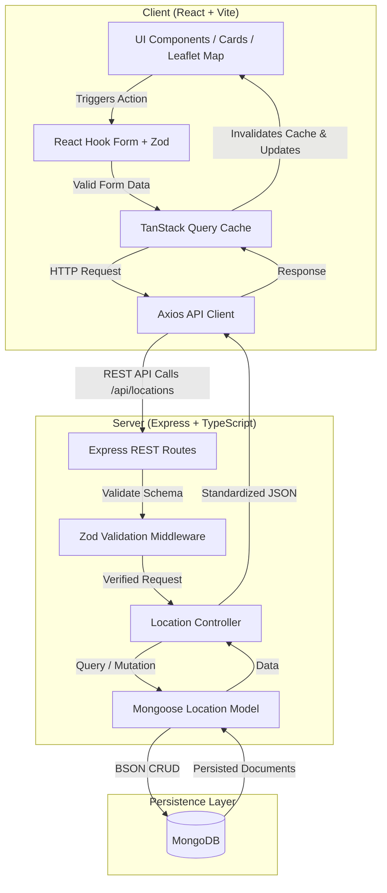

# System Architecture & Technical Decisions — Spotly

## 1. High-Level Architecture Overview

Spotly is structured as a modern decoupled full-stack web application:

---

## 2. Component Responsibilities

### Client Tier
- **Presentation (`src/components/`, `src/features/locations/components/`)**:
  - `MapExplorer`: Renders interactive Leaflet map, handles marker click events, tile rendering, and map-coordinate click detection.
  - `LocationSidebar`: Lists places filtered by search & category chips, displays count, loading skeletons, and empty states.
  - `LocationCard`: Clean visual card displaying category badge, coordinates, and action triggers (Fly To, Edit, Delete).
  - `LocationFormModal`: Accessible dialog modal supporting both create and edit modes with live coordinate inputs.
  - `DeleteConfirmDialog`: Safety barrier preventing accidental deletion of places.
- **Server State (`src/features/locations/hooks/`)**:
  - `useLocationsQuery`: Fetches locations with query params (`search`, `category`).
  - `useCreateLocationMutation`, `useUpdateLocationMutation`, `useDeleteLocationMutation`: Orchestrates optimistic/invalidation updates with toast notifications via Sonner.
- **API Communication (`src/features/locations/api/`)**:
  - Centralized Axios instance with base URL configuration and uniform error response parsing.

### Server Tier
- **Routing & Validation (`src/modules/locations/location.routes.ts`, `location.schema.ts`)**:
  - Validates request payloads and query parameters using Zod before invoking controller logic.
- **Controller (`src/modules/locations/location.controller.ts`)**:
  - Implements REST handlers for `GET`, `POST`, `PATCH`, `DELETE`.
  - Escapes special regex characters in search strings to prevent ReDoS or malformed query errors.
- **Model (`src/modules/locations/location.model.ts`)**:
  - Defines Mongoose schema with type safety, required constraints, coordinate range validation (-90 <= lat <= 90, -180 <= lng <= 180), and timestamps.

---

## 3. Key Design Decisions & Tradeoffs

1. **Why TanStack Query over Redux?**
   - Spotly's state is almost entirely server state (places from the database). TanStack Query provides out-of-the-box caching, deduplication, automatic refetching, and background cache synchronization without boilerplate reducers or actions.
2. **Why React Leaflet with OpenStreetMap?**
   - Free, open-source, lightweight, and requires no proprietary API keys or paid quotas. Ideal for full-stack portfolios and development tests.
3. **Safe Search Implementation**:
   - Rather than assuming B-tree index coverage on arbitrary regex queries, search uses regex with escaped input (`RegExp(escapeRegex(search), 'i')`). For production scale, MongoDB Atlas Search (Lucene) would be the next step.
4. **Coordinate Accuracy & Validation**:
   - Both client (Zod) and server (Zod + Mongoose) validate latitude (-90 to 90) and longitude (-180 to 180) to ensure map markers never corrupt the geospatial canvas.
